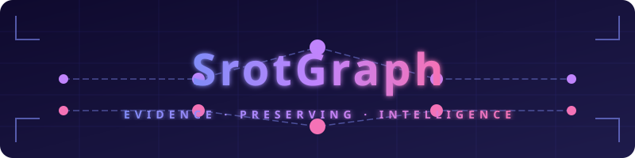

# SrotGraph



**Evidence-Preserving Intelligence System**

SrotGraph processes continuous or recorded audio, video and text streams, extracts timestamped claims, tracks claim evolution, connects evidence and sources, and measures accuracy, latency, memory consumption and information loss.

---

## System Architecture

---

## Mathematical Formulation


---

## Neural Network Architecture


---

## Evidence Gathering Pipeline


---

## Mathematical Terms

| Symbol | Term | Definition |
|--------|------|------------|
| \(C\) | Claim Set | \(C = \{c_1, c_2, ..., c_n\}\) — all extracted claims from a stream |
| \(c_i\) | Claim | A single claim: \((t_{start}, t_{end}, text, confidence)\) |
| \(s(c)\) | Confidence Score | \(P(valid \mid c, context)\) — probability claim is valid given context |
| \(s'(c)\) | Updated Score | \(s'(c) \propto s(c) \cdot \mathcal{L}(evidence \mid c)\) — Bayesian update with evidence |
| \(w(e)\) | Evidence Weight | \(w(e) = \alpha \cdot r_s + \beta \cdot v_e + \gamma \cdot t_e\) — composite evidence quality |
| \(\alpha, \beta, \gamma\) | Weights | Learned weights for source reliability, verification, and temporal proximity |
| \(r_s\) | Source Reliability | Reliability score of the evidence source (0–1) |
| \(v_e\) | Evidence Verification | Whether evidence has been verified (0 or 1) |
| \(t_e\) | Temporal Proximity | Time distance between evidence and claim |
| \(G\) | Relationship Graph | \(G = (V, E)\) where \(V = C \cup R\) — claims and relationships as vertices |
| \(e_{ij}\) | Edge | \((c_i, c_j, type, confidence)\) — relationship between two claims |
| \(type\) | Relation Type | \(\in \{\text{supports}, \text{contradicts}, \text{corroborates}, \text{related}\}\) |
| \(C^v\) | Claim Version | \(C^v = \{c^v_1, c^v_2, ..., c^v_k\}\) — version history of a claim |
| \(\Delta(c)\) | Edit Distance | \(\text{edit\_distance}(c^v_k, c^v_{k+1})\) — change magnitude between versions |
| \(L\) | Information Loss | \(L = 1 - \frac{\|C_{correct}\|}{\|C_{total}\|}\) — proportion of missed claims |
| \(L_{precision}\) | Precision Loss | \(L_p = \frac{TP}{TP + FP}\) — fraction of extracted claims that are correct |
| \(L_{recall}\) | Recall Loss | \(L_r = \frac{TP}{TP + FN}\) — fraction of true claims that were extracted |
| \(TP\) | True Positive | Correctly extracted claim |
| \(FP\) | False Positive | Incorrectly extracted claim |
| \(FN\) | False Negative | Missed claim (not extracted) |

---

## Repository Structure

This is a monorepo using pnpm workspaces for the frontend and uv for Python packages.

```
srotgraph/
├── apps/
│   ├── api/              # FastAPI backend
│   │   ├── src/
│   │   │   ├── main.py   # Application entry point
│   │   │   └── config.py # Configuration
│   │   ├── tests/
│   │   │   └── test_main.py
│   │   ├── pyproject.toml
│   │   └── Dockerfile
│   └── web/              # Next.js frontend
│       ├── src/
│       │   └── app/
│       │       ├── page.tsx      # Status page
│       │       ├── layout.tsx    # Root layout
│       │       ├── globals.css   # Global styles
│       │       └── api/
│       │           └── health/
│       │               └── route.ts  # Health API proxy
│       ├── package.json
│       ├── tsconfig.json
│       └── Dockerfile
├── packages/
│   ├── contracts/        # Shared TypeScript data contracts
│   │   ├── src/
│   │   │   └── index.ts
│   │   ├── package.json
│   │   └── tsconfig.json
│   └── python/           # Shared Python utilities
│       ├── src/
│       │   ├── __init__.py
│       │   └── config.py
│       └── pyproject.toml
├── tests/
│   ├── unit/             # Unit tests
│   ├── integration/      # Integration tests
│   └── contract/         # Contract tests
├── docs/                 # Documentation
├── migrations/           # Database migrations (future)
├── .github/
│   └── workflows/
│       └── ci.yml        # CI pipeline
├── docker-compose.yml    # Local PostgreSQL
├── pnpm-workspace.yaml   # pnpm workspace config
├── pyproject.toml        # Root Python config (uv)
├── .env.example          # Environment template
├── .gitignore
├── LICENSE
├── CONTRIBUTING.md
├── CODE_OF_CONDUCT.md
├── SECURITY.md
└── README.md
```

## Quick Start

### Prerequisites

- Python 3.12+
- Node.js 20+
- pnpm 9+
- uv (Python package manager)
- Docker and Docker Compose (for local PostgreSQL)

### Install uv

```bash
# Install uv (Python package manager)
curl -LsSf https://astral.sh/uv/install.sh | sh
```

### Install Dependencies

```bash
# Install all pnpm dependencies
pnpm install

# Install Python dependencies for API
cd apps/api
uv sync --extra dev

# Install Python dependencies for shared package
cd ../packages/python
uv sync --extra dev
```

### Start PostgreSQL (optional, for development)

```bash
docker-compose up -d
```

### Run the API

```bash
cd apps/api
uv run uvicorn srotgraph_api.main:app --reload
```

The API will be available at http://localhost:8000

- Health: http://localhost:8000/health
- Docs: http://localhost:8000/docs

### Run the Web App

```bash
cd apps/web
pnpm dev
```

The web app will be available at http://localhost:3000

## Development

### Code Quality

```bash
# Python formatting and linting (using Ruff)
cd apps/api
uv run ruff format .
uv run ruff check .

# TypeScript type checking
cd apps/web
pnpm typecheck

# ESLint
cd apps/web
pnpm lint
```

### Tests

```bash
# Run API unit tests
cd apps/api
uv run pytest tests/ -v

# Run Python package tests
cd packages/python
uv run pytest tests/ -v

# Run contract tests
cd tests/contract
uv run pytest tests/contract/ -v

# Run TypeScript/Next.js tests (when added)
cd apps/web
pnpm test
```

## Project Conventions

- **Python**: Use `uv` for dependency management, `ruff` for linting/formatting
- **TypeScript**: Strict mode, ESLint with Next.js config
- **Shared types**: Defined in `packages/contracts` and used by both apps
- **API design**: REST with JSON, versioned via URL prefix (`/api/v1/`)

## Documentation

- [Architecture](docs/ARCHITECTURE.md) - System design and component responsibilities
- [Data Model](docs/DATA_MODEL.md) - Database schema and entity relationships
- [Roadmap](docs/ROADMAP.md) - Implementation phases and priorities

## License

MIT License - see [LICENSE](LICENSE) for details.

## Contributing

See [CONTRIBUTING.md](CONTRIBUTING.md) for contribution guidelines.

## Security

See [SECURITY.md](SECURITY.md) for security reporting instructions.
